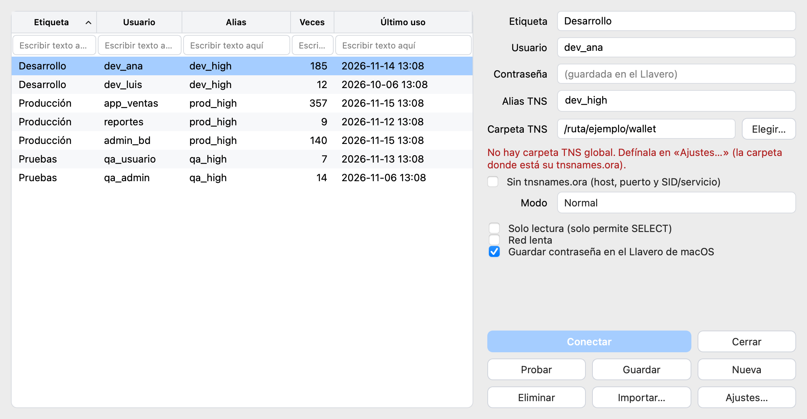

# 2. Conectarse a Oracle

Abra **Session > Connect…** (**⌘D, C**). Se muestra el **administrador de conexiones**:

## Crear su primera conexión
1. Antes, tenga a mano su **carpeta TNS**: la que contiene el archivo `tnsnames.ora`. Si usa Autonomous Database, cada alias apunta a una **wallet** mediante `(security=(my_wallet_directory=/ruta/de/la/wallet))`; la ruta debe ser la de **este Mac**.
2. En el administrador pulse **Ajustes…** y elija la carpeta TNS. Pulse **Comprobar TNS…**: el programa revisa cada alias y le dice si alguna wallet está mal.
3. Pulse **Nueva** y complete: **etiqueta** (para agrupar, p. ej. «Producción»), **usuario**, **contraseña** y **alias TNS** (se elige de la lista del `tnsnames.ora`).
4. **Probar** comprueba la conexión sin abrirla. Luego **Conectar**.

La **contraseña se guarda en el Llavero de macOS**, nunca en un archivo.

## Opciones de la conexión
| Opción | Para qué sirve |
|---|---|
| **Alias TNS** y **Carpeta TNS (opcional)** | El alias de su `tnsnames.ora`. La carpeta TNS propia de la conexión es opcional: si no la pone, se usa la global de «Ajustes…». |
| **Sin tnsnames.ora (host, puerto y SID/servicio)** | Conectarse indicando directamente el servidor, el puerto (1521) y el servicio o SID. |
| **Modo** (Normal / SYSDBA…) | Conectarse como administrador. |
| **Solo lectura (solo permite SELECT)** | La sesión rechaza cualquier escritura. Recomendado en producción. |
| **Red lenta** | Ajusta el programa para conexiones con mucha latencia. |
| **Guardar contraseña en el Llavero de macOS** | La contraseña se guarda cifrada por macOS, no en un archivo. |
| **Importar…** | Trae conexiones de un `connections.xml` de SQLTools de Windows (no incluye contraseñas). |
| **Probar / Guardar / Eliminar / Nueva / Ajustes…** | Comprueba la conexión sin abrirla; guarda los cambios; borra; crea una; y fija la carpeta TNS global. |

La lista de la izquierda se puede **filtrar** por cada columna (etiqueta, usuario, alias…) y muestra cuántas veces y cuándo usó cada conexión.

## Una vez conectado
La barra superior muestra usuario y servidor. Desde **Session**: **Commit** (⌘D, T), **Rollback** (⌘D, R), **Read Only** (⌘D, O), **Disconnect** (⌘D, D) y **Cancel** (⌘D, A) para interrumpir una consulta larga.
