# 3. La ventana principal

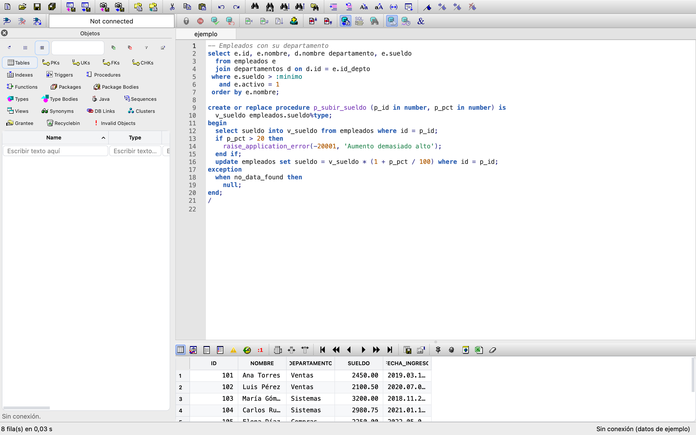

| Zona | Qué es |
|---|---|
| **Barras de iconos** (arriba) | Archivo y edición, conexión y SQL. Son los iconos originales de SQLTools. Se muestran u ocultan en **View**. |
| **Panel de objetos** (izquierda) | Tablas, vistas, paquetes… del esquema; doble clic abre el código. Filtro y botón de refrescar. |
| **Editor** (centro) | Una pestaña por script. Números de línea, plegado de código, marcadores. |
| **Panel de resultados** (abajo) | Páginas: **Result**, **Output**, **Errors**, **Statistics**, **SQL Plan**, **History**, **Binds**. Cada una tiene su botón en la barra de iconos del panel. |
| **Barra de estado** (abajo) | Mensajes: filas devueltas, tiempo, errores. |

## La lista de objetos (Alt+3)
Igual que en SQLTools de Windows, la lista tiene **una pestaña por tipo de objeto**: Tables, PKs, UKs, FKs, CHKs, Indexes, Triggers, Procedures, Functions, Packages, Package Bodies, Types, Type Bodies, Java, Sequences, Views, Synonyms, DB Links, Clusters, Grantee, Recyclebin e Invalid Objects. Cada pestaña muestra sus propias columnas (por ejemplo, en Indexes: tabla, unicidad, columnas, estado) y debajo del encabezado hay una **fila de filtros por columna** (“Escribir texto aquí”). Se puede ordenar con clic en el encabezado.

| Control | Qué hace |
|---|---|
| Barra superior | Refrescar, vista lista/informe, mostrar válidos/inválidos, filtro y ajustes. |
| Selector de esquema | Cambia el esquema de la lista. |
| Botones de pestaña | Cada uno con el icono original; el menú de la lista permite ocultar los títulos (*Tab titles*). |

Al conectar, la lista **precarga en segundo plano** las demás pestañas (de una en una), de modo que cambiar de pestaña es inmediato; **Refresh** o cambiar de esquema vuelven a leerlas. Los bordes, botones, cabeceras y barras de desplazamiento tienen un aspecto moderno y siguen el modo claro u oscuro del sistema.

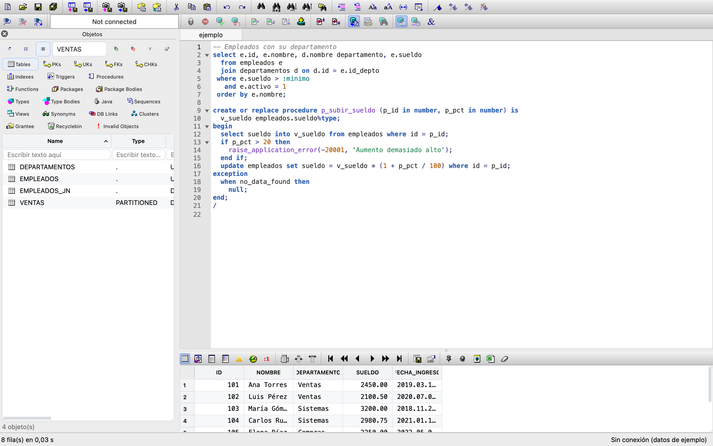

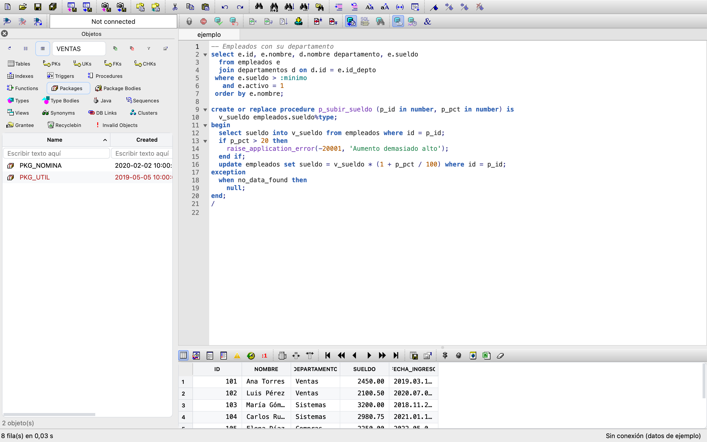

## El panel de objetos y su menú contextual
Con **clic derecho** sobre un objeto aparece un menú que cambia según el tipo de objeto (igual que en SQLTools de Windows). Se pueden seleccionar **varios objetos** a la vez (⌘clic o ⇧clic).

| Entrada | Qué hace |
|---|---|
| **Refresh** | Vuelve a leer la lista de objetos del esquema. |
| **Query** (F11) | Tablas y vistas: muestra las primeras filas (`select *`). |
| **Show in Object Viewer** (F12) | Abre el *Object Viewer* con las propiedades del objeto (columnas, restricciones, índices, triggers, referencias, dependientes y permisos). |
| **Load DDL** (⌘F12) | Pregunta las opciones (*Local DDL Preferences*) y abre el DDL del objeto: en una tabla, `CREATE TABLE` + índices, restricciones, triggers, comentarios y permisos. Es la acción por defecto; el doble clic la hace con los valores predeterminados, sin preguntar. |
| **Load DDL in one file** | El DDL de **todos los objetos seleccionados** en una sola pestaña. |
| **Load DDL with Dbms_Metadata** (⌥F12) | Igual que Load DDL pero siempre con `DBMS_METADATA`. |
| **Drop** | Borra el objeto. Muestra la sentencia y **pide confirmación**. |
| **Truncate** | Solo tablas: vacía la tabla (pide confirmación). |
| **Create Transformation Script** | Solo tablas: genera el script para reconstruir la tabla (ver Table Transformation Helper). |
| **Compile** | Procedimientos, funciones, paquetes, tipos, triggers, vistas y sinónimos: `alter … compile`. |
| **Enable / Disable** | Solo triggers. |
| **Compile All Invalid with Dbms_Utility** | Aparece sobre un objeto inválido (✗): compila todos los inválidos del esquema. |
| **Copy / Select All** | Copia los nombres seleccionados / selecciona todos los objetos visibles. |
| **Filter…** | Muestra solo los objetos cuyo nombre contiene un texto. |
| **View** | *Short List* (solo nombres) o *Detail List* (con el estado VALID/INVALID). |
| **DDL Preferences…** | Abre Settings en la pestaña DDL (valores predeterminados de Load DDL). |

Las acciones que **modifican la base** (Drop, Truncate, Compile, Enable/Disable) muestran antes la sentencia exacta y piden confirmación; se ejecutan como cualquier script, así que respetan el modo **Read Only** y quedan en el historial.

| Tabla | Paquete | Trigger | Objeto inválido |
|---|---|---|---|
| 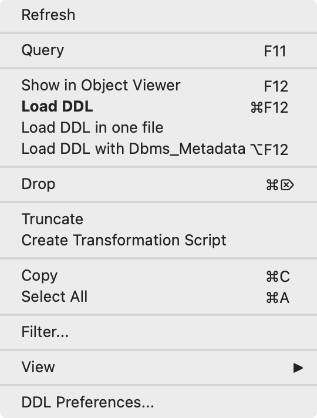 | 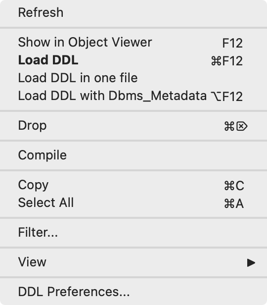 | 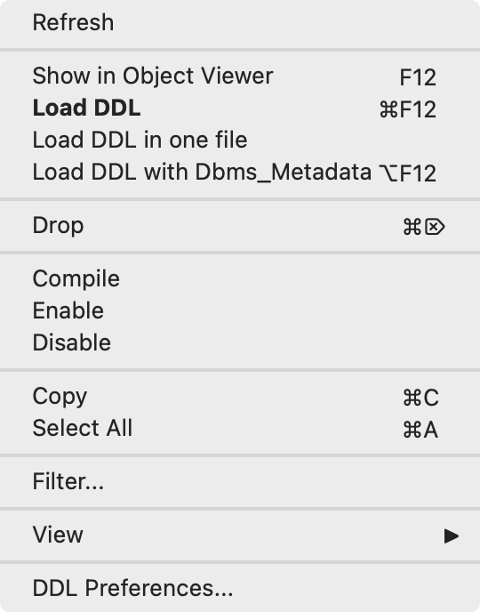 | 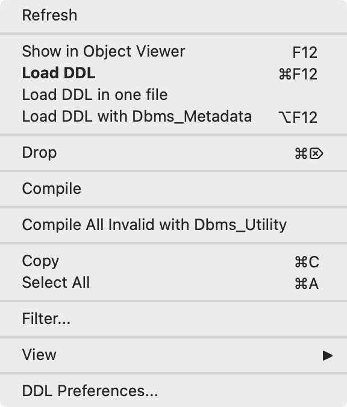 |

## Object Viewer (F12)
Con el cursor sobre el nombre de una tabla (o de cualquier objeto) pulse **F12**: se abre el **Object Viewer** a la derecha con las propiedades del objeto, organizadas en un árbol como en SQLTools de Windows.

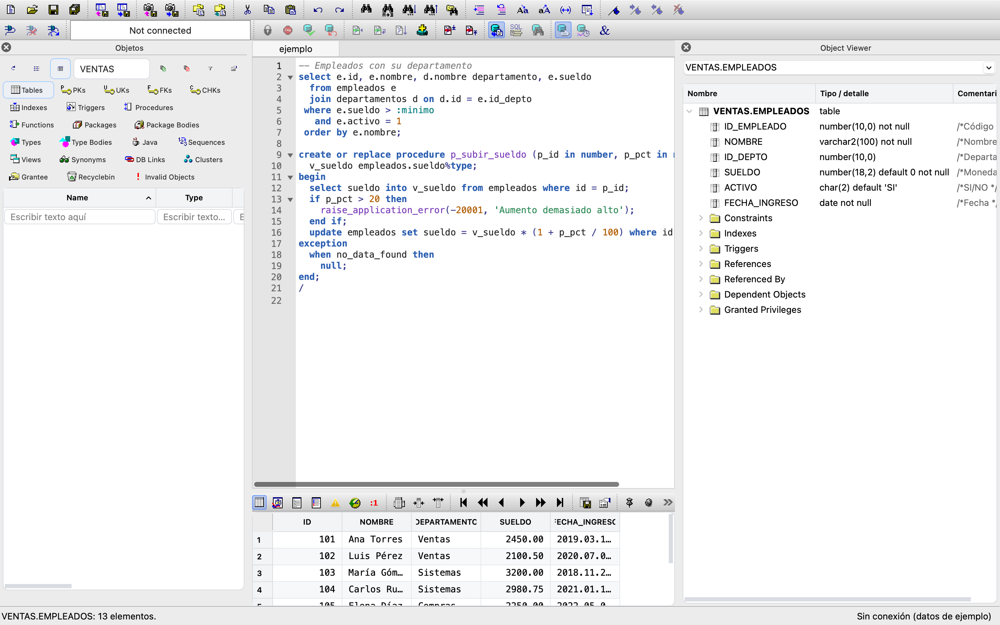

### Arrastrar al editor
Igual que en SQLTools de Windows, se puede **arrastrar** un elemento del Object Viewer hasta el editor (o hacer **doble clic** sobre él, o usar **Insert at Cursor** en su menú) y se escribe el texto adecuado:

| Elemento | Qué se inserta |
|---|---|
| **Procedimiento o función** (de un paquete o suelto) | `nombre(p_uno => , p_dos => );`, listo para completar los parámetros. |
| **Tabla, vista, paquete, secuencia…** | Su nombre (con el esquema si **Schema prefix** está activo en Settings > DDL). |
| **Columna** | El nombre de la columna. |
| **Índice o constraint** | Su nombre. |
| **Varios elementos seleccionados** | Sus nombres separados por coma, en líneas de hasta 60 caracteres. |

Con **⇧** pulsado al soltar, la columna lleva su tipo y los índices/constraints insertan sus columnas; con **⌘**, los parámetros de un procedimiento salen en líneas alineadas. En **Settings > Editor > Object Viewer** se elige si el doble clic inserta, si se antepone el nombre del paquete y el largo máximo de línea.

Los **índices** y **constraints** se expanden hacia abajo y muestran sus columnas en orden (posición, `desc`, expresiones de índices funcionales); los CHECK muestran su condición entre corchetes y los índices llevan la marca `[unique]`. Los iconos son los originales de SQLTools.

| En una tabla o vista | Qué muestra |
|---|---|
| Columnas | Nombre, tipo (`number(10,0) not null`, `char(2) default 'SI'`…) y el comentario de la columna. |
| **Constraints** | Clave primaria, únicas, foráneas y CHECK (los `NOT NULL` ya se ven en cada columna). |
| **Indexes** | Índices con sus columnas (`unique` si lo son). |
| **Triggers** | Triggers de la tabla, con su evento y estado. |
| **References** | A qué otras tablas apunta (claves foráneas). |
| **Referenced By** | Qué tablas apuntan a esta. |
| **Dependent Objects** | Vistas, paquetes, procedimientos… que usan la tabla. |
| **Granted Privileges** | Quién tiene permisos y cuáles. |

### Navegar por los objetos relacionados
Cada **tabla, vista, trigger, paquete, procedimiento, función o sinónimo** que aparece dentro del árbol (en *Triggers*, *References*, *Referenced By*, *Dependent On*, *Dependent Objects*) se puede **abrir con su flecha** y muestra a su vez lo suyo: una tabla, sus columnas y carpetas; un trigger, de qué depende (*Dependent On*: los paquetes, sinónimos y tablas que usa) y qué depende de él. Así se puede seguir una cadena de dependencias sin salir del panel.

### Clic derecho en el Object Viewer
Sobre un objeto del árbol aparece un menú según su tipo:

| Entrada | Qué hace |
|---|---|
| **Copy** | Copia el nombre y el detalle. |
| **Load DDL** (⌘F12) / **Load DDL with Dbms_Metadata** (⌥F12) | Abre el DDL del objeto en una pestaña. |
| **Query** (F11) / **Count query** (⌘F11) | Solo tablas y vistas: muestra las primeras filas o cuenta las filas. |
| **Sort order** | Solo tablas y vistas: ordena las columnas **por posición** o **por nombre**. |
| **Refresh** / **Purge Cache** | Vuelve a leer el objeto (y la lista de objetos). |
| **Settings...** | Abre los ajustes. |

Para **paquetes, procedimientos y funciones** muestra los subprogramas y sus parámetros; para **secuencias**, sus propiedades; para **sinónimos**, su destino; para **triggers** y **tipos**, sus datos principales. La lista de arriba guarda los objetos ya vistos; escriba un nombre y pulse Intro para ver otro.

## Paneles laterales opcionales
Se abren desde **View** (⌥0 … ⌥9) y aparecen como pestañas a los lados:

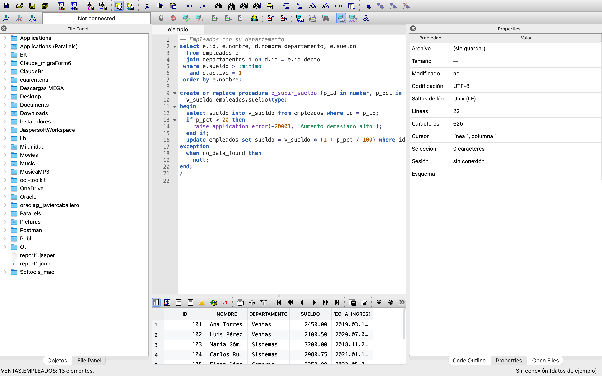

**File Panel** (⌥0), **Object Viewer** (⌥1), **Properties** (⌥2), **Object List** (⌥3), **Code Outline** (⌥4), **Snippets** (⌥5), **Find in Files Output** (⌥7), **History** (⌥8) y **Open Files** (⌥9).

## Los menús
Los menús son los del SQLTools original, con los atajos adaptados al Mac. Los comandos de cada uno están explicados en el Apéndice A.

| | |
|---|---|
| 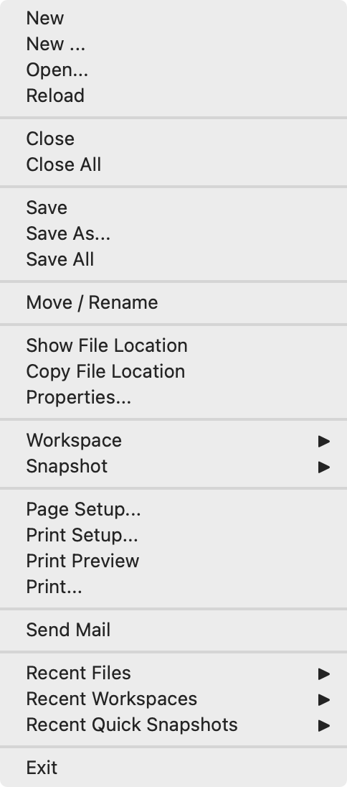 **File** | 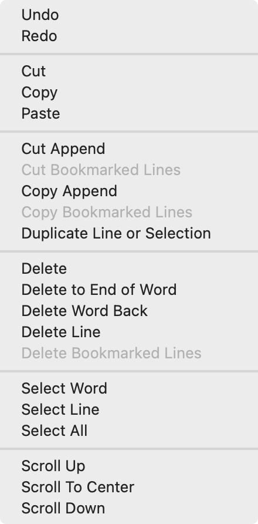 **Edit** |
| 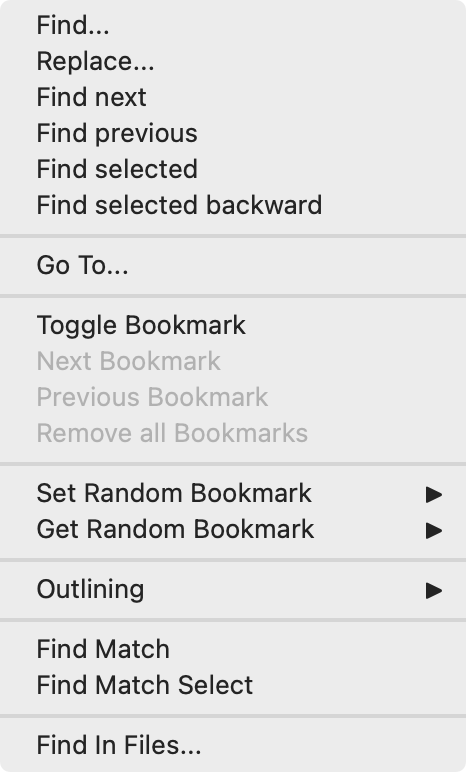 **Search** | 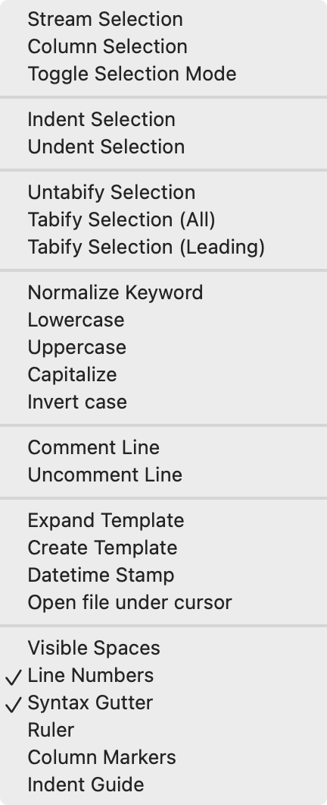 **Text** |
| 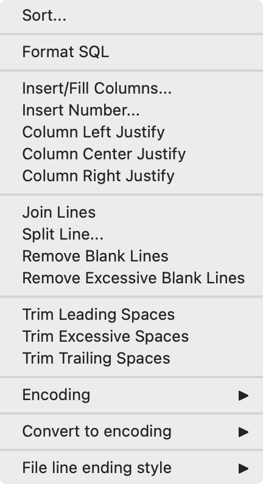 **Text/Format** | 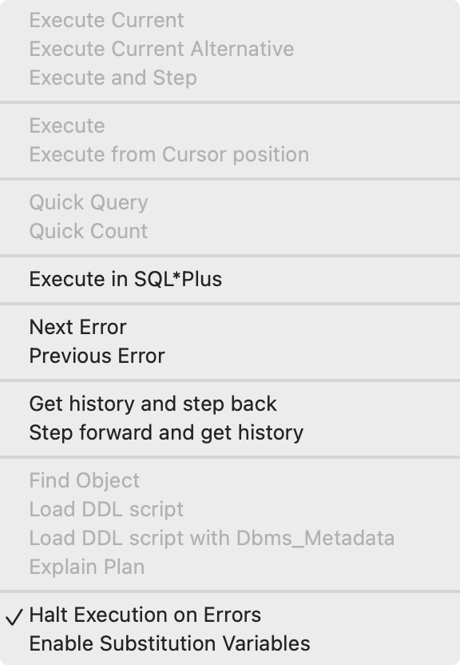 **Script** |
| 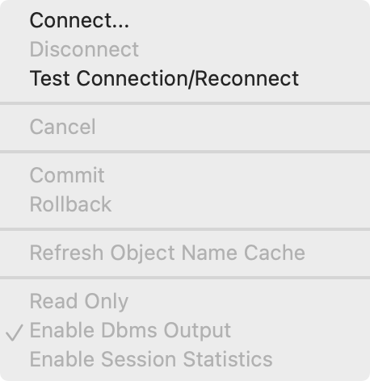 **Session** | 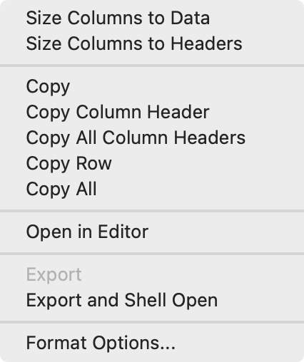 **Grid** |
| 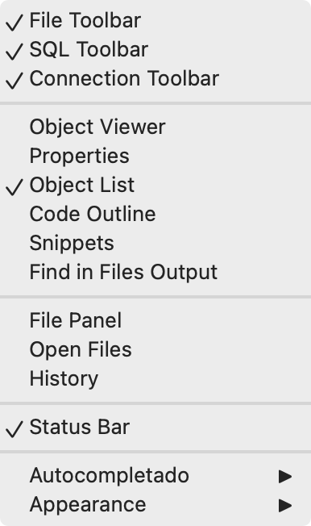 **View** | 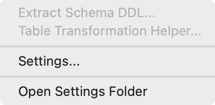 **Tools** |
