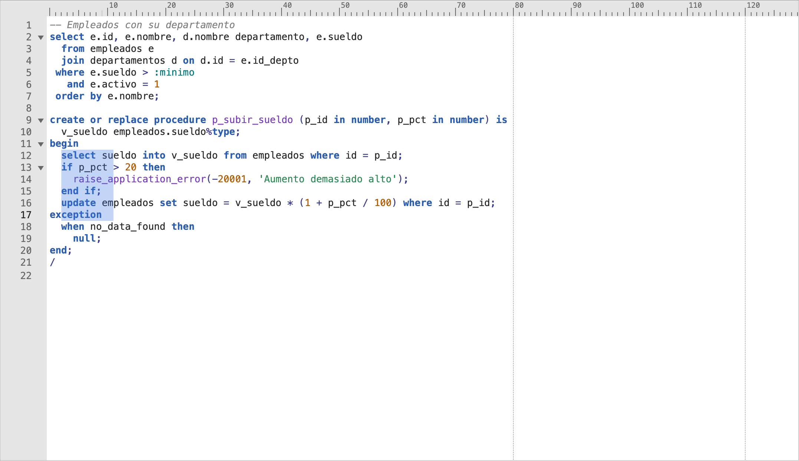

# 4. Escribir código

## Lo básico
Escriba o abra un archivo (**⌘O**). Cada script es una pestaña. **⌘S** guarda; el programa conserva la codificación y los saltos de línea originales (UTF-8, ANSI, CRLF…).

## Autocompletado
Por defecto **no se abre solo**: pulse **⌃Espacio** donde quiera sugerencias. Si hay una sola coincidencia, se inserta directamente.
- Entiende **alias** (`select e.` ofrece las columnas de la tabla de `e`), CTE, subconsultas, esquemas (`esquema.`) y paquetes (`pkg.` ofrece sus procedimientos).
- Las **plantillas** (`sel`, `proc`, `pkg`, `trg`…) se expanden con la misma tecla. Cree las suyas con **Text > Create Template**.
- Puede cambiar cuándo se abre y qué tipos de objeto ofrece en **Tools > Settings > Autocompletado** (capítulo 9).

## Selección en columna
Edite varias líneas a la vez: **⇧⌥↓** crea un cursor vertical; **⇧⌥→** lo ensancha en un bloque. Lo que escriba se aplica a todas las líneas. Copiar, cortar y pegar funcionan por filas. **Esc** sale.

Con el bloque seleccionado: **Insert/Fill Columns** (⌘K, B), justificar a izquierda/centro/derecha (⌘K, Y / V / W) e **Insert Number** (⌘K, M).

## Ayudas visuales (menú Text)
**Ruler** (⌃Q, U) regla de columnas · **Indent Guide** (⌃Q, G) guías de sangría · **Column Markers** (⌃Q, M) marcas en las columnas 80 y 120 · **Visible Spaces** (⌃Q, I) espacios y tabuladores visibles · **Line Numbers** (⌃Q, L).

## Plegado y marcadores
Oculte bloques con **⌃M, M** (o los niveles con ⌃M, 1/2/3). Marque líneas con **⌘F2** y salte con **F2**; hay 10 marcadores numerados (**⇧⌘0…9** para poner, **⌘0…9** para ir).

## Window > Split
**⌥⇧P** muestra una segunda vista del mismo script (para ver la declaración mientras escribe el cuerpo de un paquete largo).
