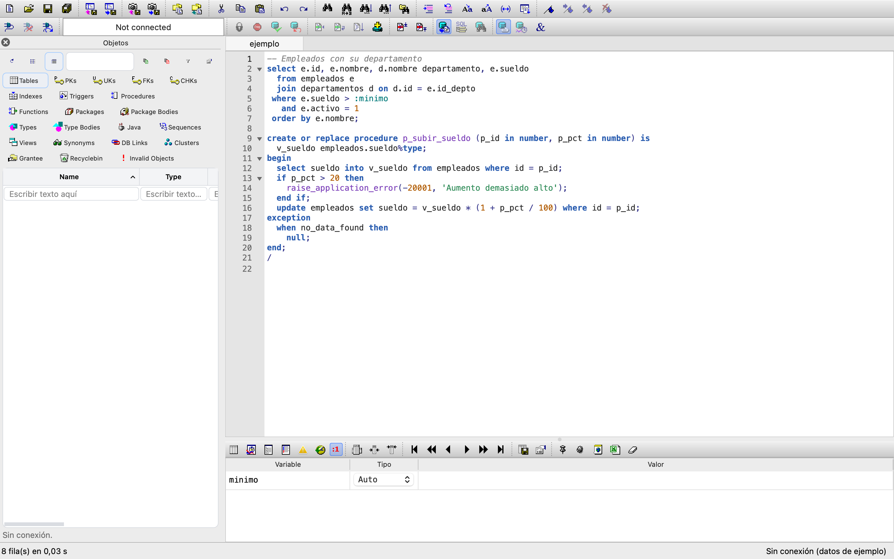
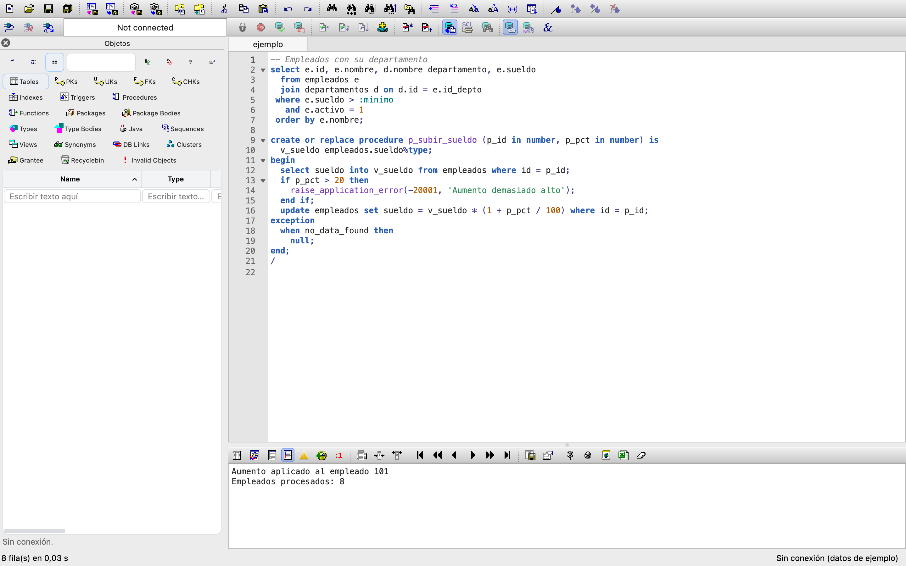
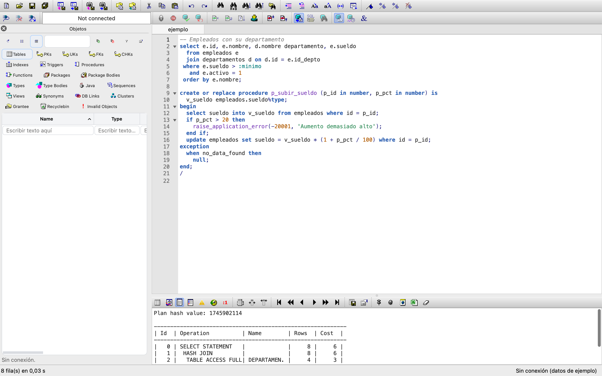
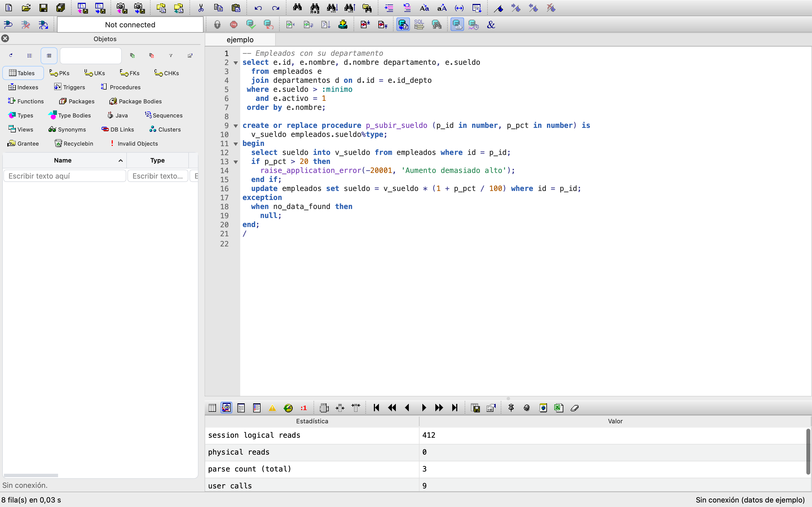
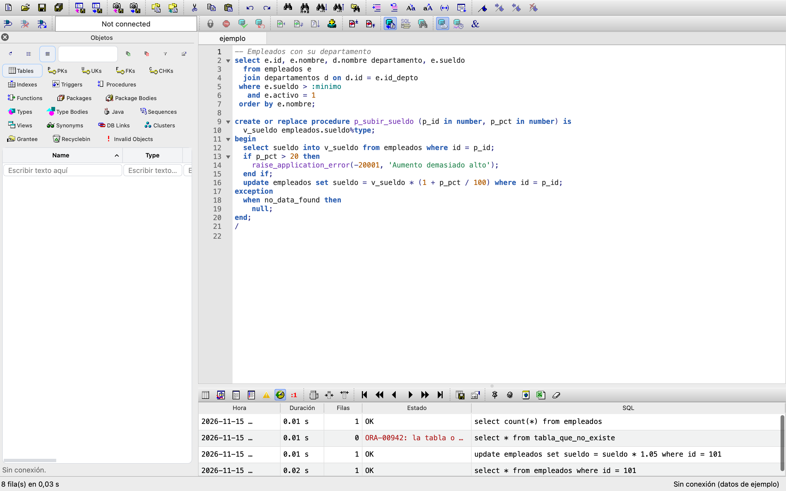

# 5. Ejecutar código

| Orden | Atajo | Qué ejecuta |
|---|---|---|
| **Execute** | F5 | La sentencia donde está el cursor (o la selección). |
| **Execute Current** | F10 / ⌘↵ | Igual; el criterio de «sentencia» lo elige en Settings. |
| **Execute Current Alternative** | ⌥F10 | El otro criterio (bloque entre líneas en blanco). |
| **Execute from Cursor** | ⌘F5 | Desde el cursor hasta el final. |
| **Execute and Step** | ⌘F10 | Ejecuta y salta a la siguiente sentencia (recorrer un script paso a paso). |
| **Quick Query / Quick Count** | F11 / ⌘F11 | `select *` / `count(*)` del objeto bajo el cursor. |
| **Explain Plan** | F9 | Plan de ejecución, sin ejecutar la consulta. |

Una sentencia termina en `;` (o en una línea con solo `/` si es PL/SQL). Si el script tiene varias consultas, **cada resultado va en su propia pestaña**.

## Variables de enlace (:nombre)
Si la sentencia contiene `:minimo`, abra la página **Binds** del panel de resultados y escriba su valor antes de ejecutar.

## Variables de sustitución (&nombre)
Active **Script > Enable Substitution Variables** y las variables `&nombre` y `&&nombre` pedirán su valor al ejecutar, como en SQL*Plus.

## Errores de compilación
Al crear un procedimiento o paquete con errores, la página **Errors** los lista; **F4** / **⇧F4** saltan al siguiente / anterior error en el editor.

## DBMS_OUTPUT
Active **Session > Enable Dbms Output** y la salida de `dbms_output.put_line` aparece en la página **Output**.

## Estadísticas y plan
**Enable Session Statistics** muestra, tras cada ejecución, los contadores de la sesión (útil para comparar dos versiones de una consulta). **F9** muestra el plan:

## Transacciones
Los cambios (INSERT/UPDATE/DELETE) **no se confirman solos**: use **Commit** (⌘D, T) o **Rollback** (⌘D, R), o active el *commit automático* en Settings. Al desconectar o cerrar con cambios sin confirmar, el programa hace lo que usted elija en Settings (deshacer, confirmar o preguntar).

## Historial
La página **History** guarda cada sentencia ejecutada, con su tiempo, filas y error. Recórrala con **⌘D, S** (atrás) y **⌘D, F** (adelante) para recuperar sentencias en el editor.

