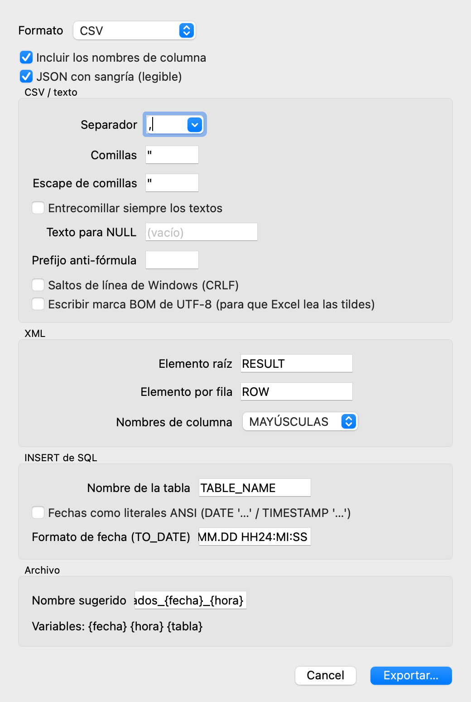

# 6. Resultados y exportación

## La rejilla
Las filas se traen por lotes (por defecto 10 000 por viaje de red), lo que la hace muy rápida incluso contra bases remotas. Los números se alinean a la derecha y los NULL aparecen en gris como `(null)`.

| Herramienta (menú **Grid**) | Qué hace |
|---|---|
| **Copy Row / Copy Column Header / Copy All** | Copian al portapapeles. |
| **Export** | Guarda a archivo con el formato que elija (abajo). |
| **Export and Shell Open** | Exporta a un archivo temporal y lo abre con la aplicación por defecto (Excel, Numbers…). |
| **Open in Editor** | Abre el resultado como texto en una pestaña. |
| **Rotate** | Gira la rejilla: cada columna pasa a ser una fila (ideal para un registro con muchas columnas). |
| **Pin** | Fija el resultado actual para que no se sobrescriba con la siguiente ejecución. |
| **Size Columns to Data / Headers** | Ajusta el ancho de las columnas. |

## Exportar
**Grid > Export** abre este diálogo:

| Formato | Detalles |
|---|---|
| **CSV** | Separador, comillas y escape configurables; entrecomillar siempre; texto para NULL; saltos CRLF; marca BOM de UTF-8 (para que Excel lea las tildes); prefijo anti-fórmula. |
| **TSV** | Separado por tabuladores. |
| **JSON** | Lista de objetos; números sin comillas, `null` real; legible o compacto. |
| **XML** | Elemento raíz y de fila configurables; nombres de columna en mayúsculas/minúsculas. |
| **INSERT de SQL** | Una sentencia `INSERT` por fila; comillas escapadas; fechas con `TO_DATE` (formato editable) o literales ANSI. |
| **HTML / Texto alineado** | Tabla HTML; texto en columnas. |

Los valores iniciales de cada destino (archivo, portapapeles, editor) se fijan en **Tools > Settings > Exportación** (capítulo 9).
