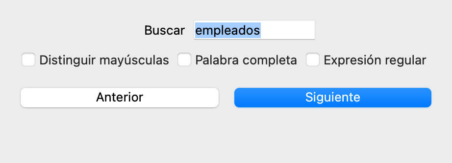
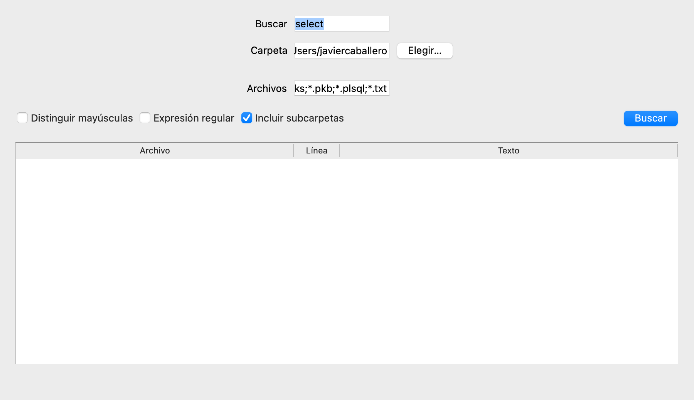

# 7. Buscar, archivos y sesiones de trabajo

## Buscar y reemplazar
**⌘F** busca y **⌃H** reemplaza, con opciones de mayúsculas, palabra completa y expresiones regulares.

**F3** / **⇧F3** siguiente/anterior. **⌘F3** busca el texto seleccionado sin abrir el diálogo. **⌘]** salta al paréntesis o BEGIN/END pareja.

## Buscar en archivos
**⇧⌘F** busca texto dentro de todos los archivos de una carpeta (máscaras, subcarpetas, mayúsculas, regex). Doble clic en un resultado abre el archivo en esa línea.

## Archivos recientes, workspaces y snapshots
- **File > Recent Files**: los 12 últimos.
- **Workspace** (⇧⌘W, S/A/O/L): guarda el conjunto de pestañas (también los borradores sin guardar) en un archivo `.sqlws` para retomar un trabajo exactamente donde lo dejó.
- **Snapshot** (⇧⌘W, Q/T/C/V): «fotos» rápidas sin nombre. **Al cerrar el programa se guarda una automática**, así que puede recuperar un borrador cerrado sin guardar con **Snapshot > Open AS/QS…**.

## Codificaciones
Si un archivo muestra `ñ` en vez de `ñ`: **Text/Format > Encoding > UTF-8 / ANSI / OEM** relee el archivo con otra tabla. **Convert to encoding** cambia cómo se guardará.
