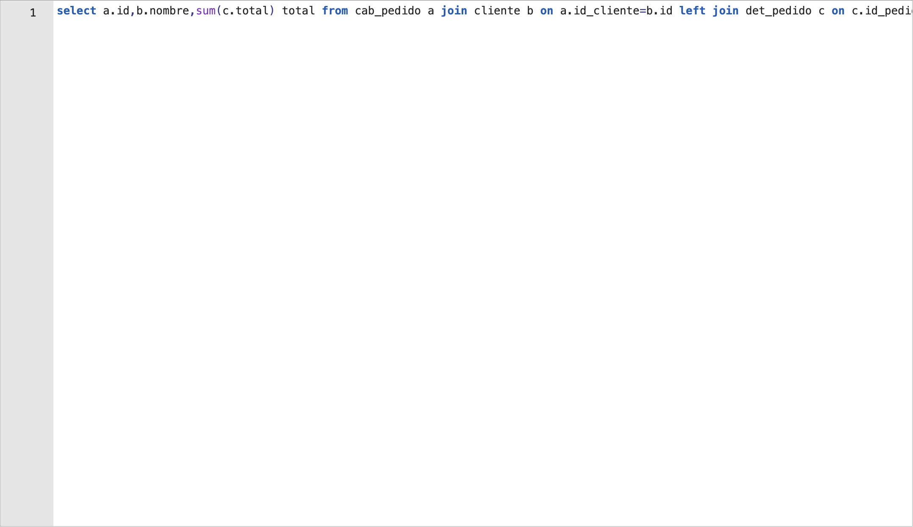
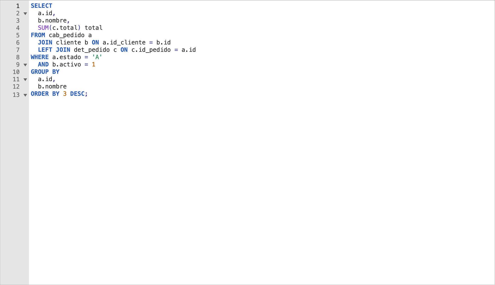

# 8. Format SQL: que el código quede con su estilo

**⌘K, E** reescribe SQL y PL/SQL con un estilo uniforme **sin cambiar lo que hace**. Sin selección formatea la sentencia donde está el cursor; con selección, solo ese texto. Se deshace con **⌘Z**.

**Antes**

**Después** (estilo Estándar, sangría 2)

## Qué formatea
- **SQL** (SELECT, INSERT, UPDATE, DELETE, MERGE, WITH): una cláusula por línea, columnas una por línea, `AND`/`OR` en línea propia, `JOIN` en líneas propias, subconsultas sangradas. No toca textos entre comillas, comentarios ni *hints*.
- **PL/SQL** (bloques, procedimientos, funciones, paquetes, triggers): re-sangra `BEGIN/END`, `IF`, `LOOP`, `CASE`, `EXCEPTION`/`WHEN` y declaraciones, y formatea las sentencias SQL que contienen.
- El **DDL** (CREATE TABLE, etc.) se deja como está.

## Definir su propia estructura
En **Tools > Settings > Format SQL** (capítulo 9) tiene unas 20 reglas y una **vista previa con su propio código**. Hay tres caminos:
1. **Ajustar las reglas** a mano (sangría, estilo, dónde va AND/OR, JOIN, comas, mayúsculas, alineado de declaraciones…).
2. **Deducir de un ejemplo**: pegue código que *ya* tenga el formato que le gusta y el programa deduce las reglas.
3. **Importar un perfil** `.sqlfmt` de un compañero, para que todo el equipo formatee igual.

Guarde lo que defina como **perfil** con nombre y cámbielo cuando quiera.

> Es un formateador propio: en PL/SQL muy complejo puede dar un resultado algo distinto al de SQLTools para Windows. Compruebe siempre el resultado con *Deshacer* a mano.
