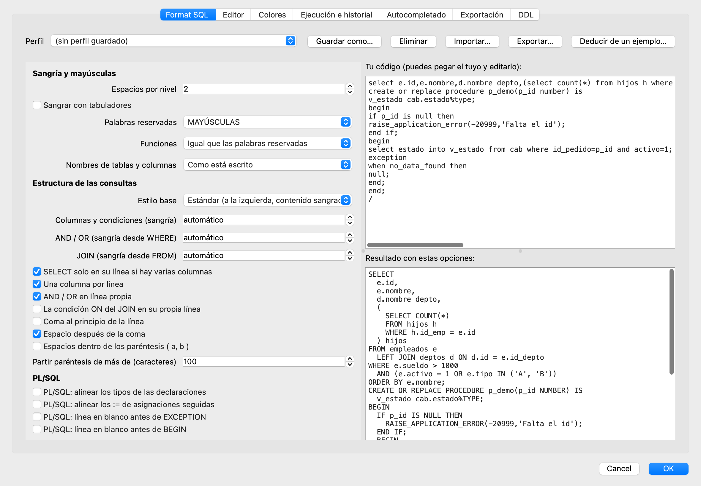
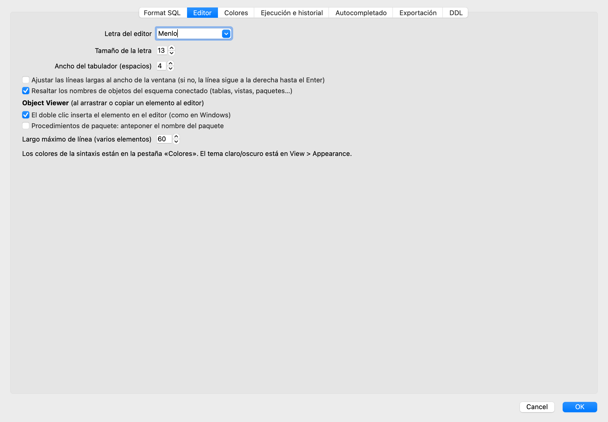
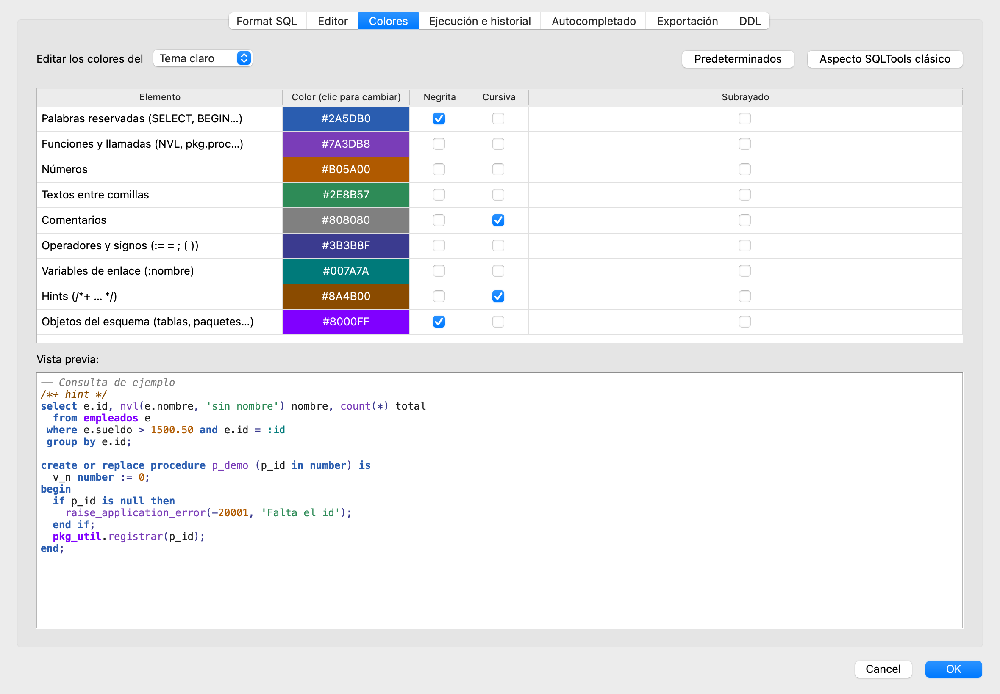
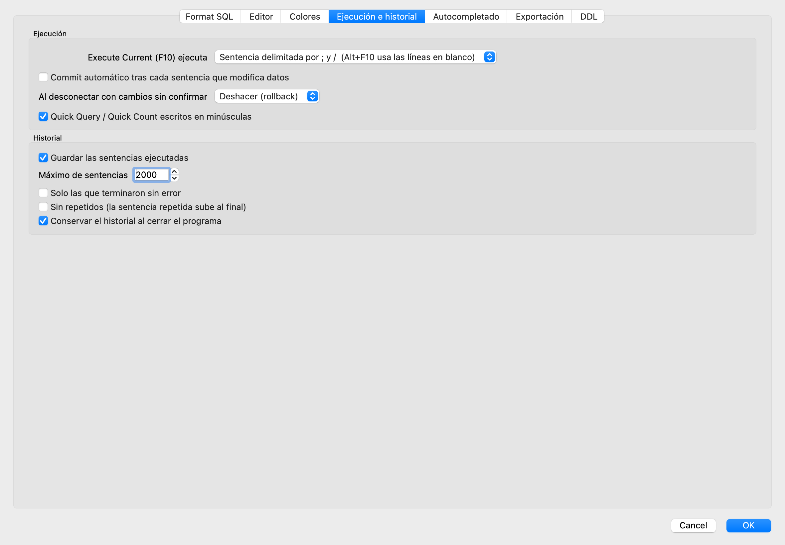
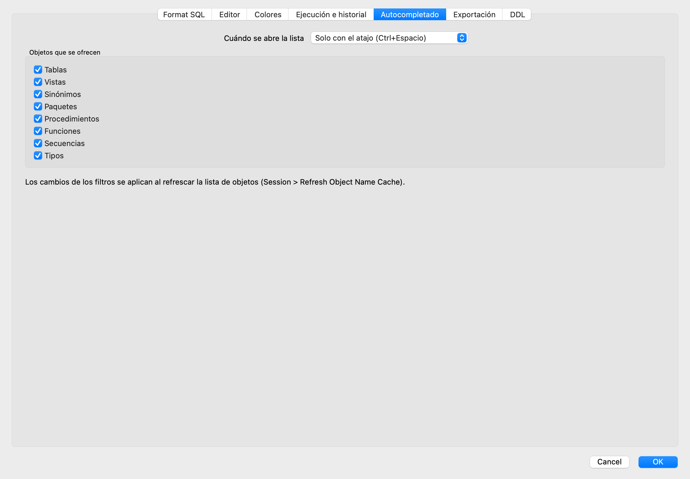
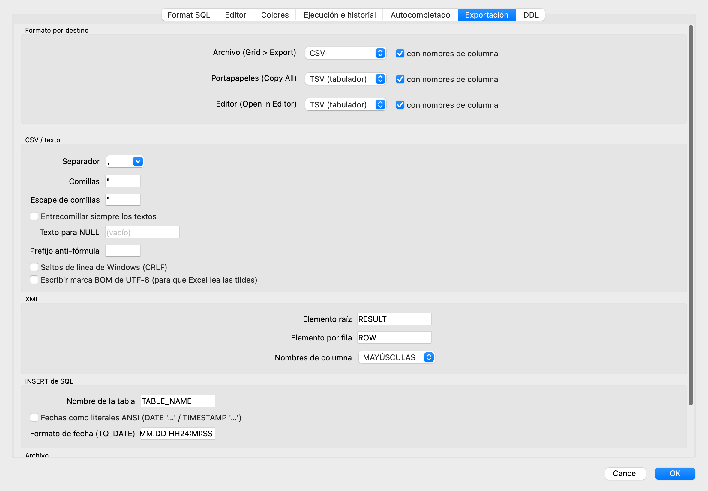
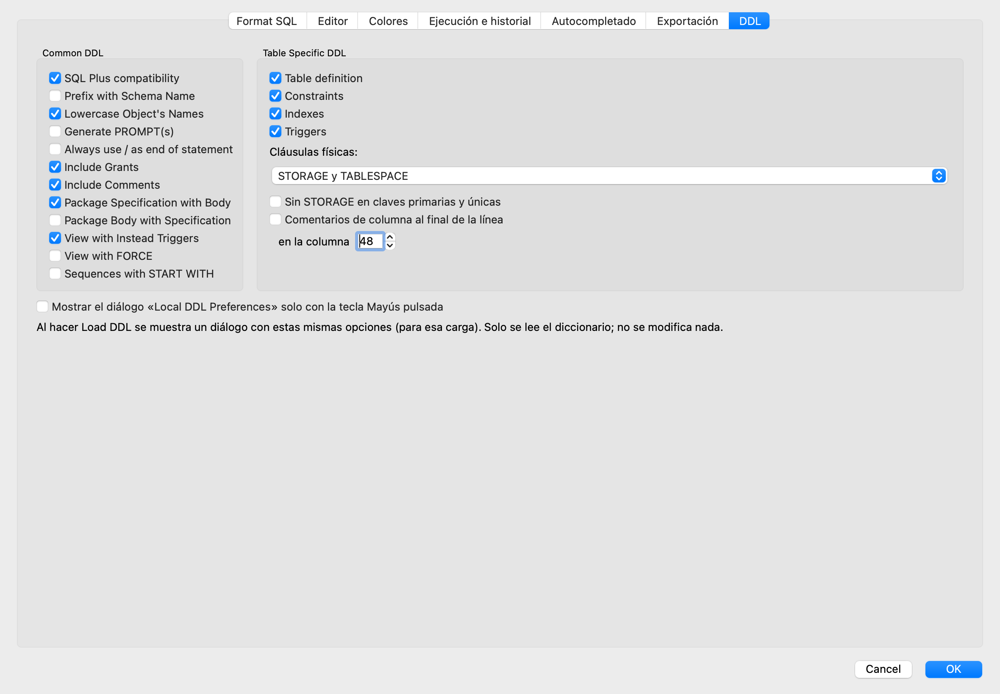
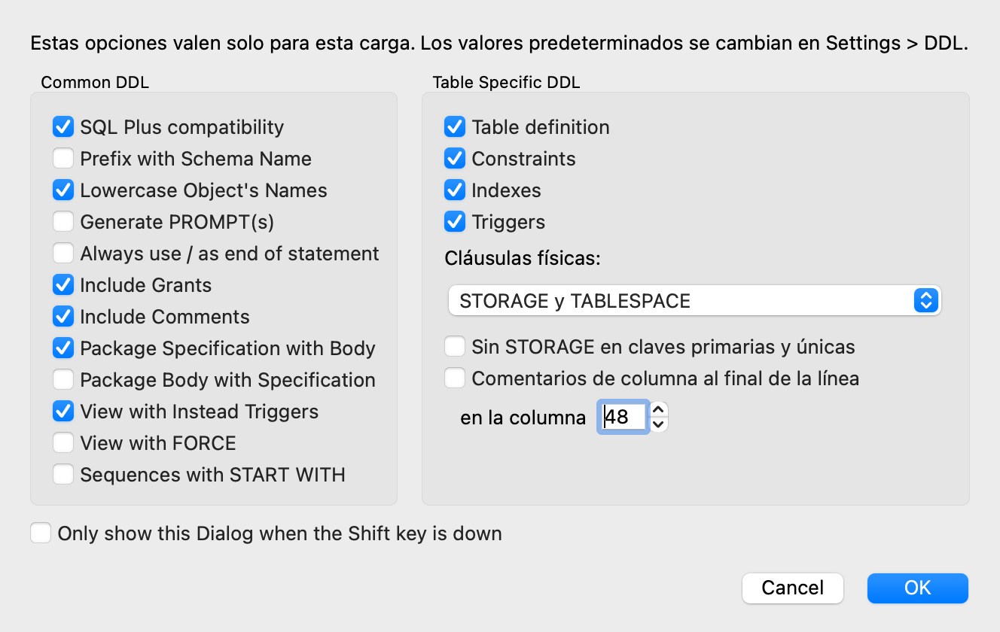

# 9. Configuración (Tools > Settings)

**Tools > Settings…** (**⌃Q, P**) reúne todos los ajustes en pestañas. **OK** guarda y aplica a todas las pestañas abiertas; **Cancel** descarta. Otros ajustes están en menús: **View > Appearance** (tema), **View > Autocompletado** (modo), **Grid > Format Options** (filas por viaje, texto para NULL), **Session** (Read Only, Dbms Output, estadísticas) y **Script > Halt Execution on Errors**.

## 9.1 Format SQL

Arriba, los **perfiles** (guardar, eliminar, importar, exportar y *deducir de un ejemplo*). A la izquierda, las reglas; a la derecha, su código y el resultado en vivo.

| Ajuste | Qué controla |
|---|---|
| Espacios por nivel · tabuladores | Ancho de la sangría (1–8) o tabuladores. |
| Palabras reservadas / Funciones / Nombres de tablas y columnas | MAYÚSCULAS, minúsculas o como estén; cada grupo por separado. |
| Estilo base | **Estándar** (palabras a la izquierda) o **Riachuelo** (alineadas por la derecha). |
| Columnas y condiciones (sangría) | A cuántas columnas de la palabra (SELECT, WHERE…) van. «automático» = según el estilo. |
| AND / OR (sangría desde WHERE) | `0` = AND justo bajo WHERE. |
| JOIN (sangría desde FROM) | A cuántas columnas de FROM empiezan los JOIN. |
| SELECT solo en su línea | Con varias columnas: la palabra sola y las columnas debajo, o la primera columna junto a la palabra. |
| Una columna por línea · AND/OR en línea propia · ON en línea propia | Cómo se parten las listas y condiciones. |
| Coma al principio · espacio tras la coma · espacios en paréntesis | Puntuación. |
| Partir paréntesis de más de N caracteres | Los paréntesis largos se parten uno por línea. |
| PL/SQL: alinear declaraciones y `:=` · líneas en blanco antes de EXCEPTION y BEGIN | Estructura de los bloques PL/SQL. |

## 9.2 Editor

| Ajuste | Qué controla |
|---|---|
| Letra del editor | Solo tipos monoespaciados (por defecto Menlo). |
| Tamaño de la letra | 8 a 32 puntos. |
| Ancho del tabulador | Espacios por tabulador (1–12). |

## 9.3 Colores

Elija el tema (**claro** u **oscuro**; cada uno tiene sus colores) y, para cada elemento —palabras reservadas, funciones, números, textos, comentarios, operadores, variables `:x`, hints y **objetos del esquema**— el **color** (clic en el cuadro), **negrita**, **cursiva** y **subrayado**. La vista previa se actualiza al instante. **Predeterminados** restaura los de fábrica; **Aspecto SQLTools clásico** imita los colores de la versión de Windows.

**Objetos del esquema.** Igual que en SQLTools de Windows, al conectar, los nombres de tablas, vistas, paquetes, procedimientos, funciones, secuencias, sinónimos, tipos, índices y triggers **del esquema de la sesión** se pintan con su propio color (por defecto lila `#8000FF` y negrita, el mismo de Windows). Reglas, tomadas del programa original: se compara cada palabra sin distinguir mayúsculas; las palabras reservadas y el texto dentro de comentarios y cadenas no se pintan como objeto; sin conexión no hay color. Se puede desactivar en **Editor > Resaltar los nombres de objetos del esquema**.

## 9.4 Ejecución e historial

| Ajuste | Qué controla |
|---|---|
| Execute Current (F10) ejecuta | **Sentencia delimitada por `;` y `/`** o **bloque entre líneas en blanco**. ⌥F10 usa el otro. |
| Commit automático | Confirma tras cada sentencia que modifica datos. **Desactivado por defecto.** |
| Al desconectar con cambios sin confirmar | **Deshacer**, **Confirmar** o **Preguntar** (también al cerrar el programa). |
| Quick Query en minúsculas | `select * from…` o `SELECT * FROM…`. |
| Guardar las sentencias ejecutadas | Activa o desactiva el historial. |
| Máximo de sentencias | Hasta 100 000 (por defecto 2000). |
| Solo las que terminaron sin error | No guarda las que fallaron. |
| Sin repetidos | Una sentencia repetida sube al final en vez de duplicarse. |
| Conservar al cerrar | Si no, el historial se pierde al cerrar. |

## 9.5 Autocompletado

| Ajuste | Qué controla |
|---|---|
| Cuándo se abre la lista | **Solo con el atajo** (⌃Espacio, por defecto), **automático después del punto** (`alias.`) o **siempre automático**. |
| Objetos que se ofrecen | Tablas, vistas, sinónimos, paquetes, procedimientos, funciones, secuencias, tipos. Los cambios se aplican al refrescar la lista de objetos. |

## 9.6 Exportación

| Ajuste | Qué controla |
|---|---|
| Formato por destino | Formato inicial y si lleva nombres de columna, para **Archivo**, **Portapapeles** y **Editor**. |
| CSV / texto | Separador (`,` `;` `|` TAB u otro), comillas, escape, entrecomillar siempre, texto para NULL, saltos CRLF, marca BOM, prefijo anti-fórmula. |
| XML | Elemento raíz y de fila; mayúsculas/minúsculas de los nombres. |
| INSERT de SQL | Nombre de la tabla; literales ANSI; formato de fecha de `TO_DATE`. |
| Archivo | Nombre sugerido con `{fecha}`, `{hora}` y `{tabla}`. |

## 9.7 DDL

Son los valores **predeterminados** de **Load DDL**, las mismas opciones del diálogo *Local DDL Preferences* de SQLTools para Windows. Se dividen en dos páginas: **Common DDL** (a la izquierda) y **Table Specific DDL** (a la derecha).

| Ajuste | Qué controla |
|---|---|
| SQL Plus compatibility | El DDL se puede ejecutar en SQL*Plus: sin líneas en blanco dentro de las vistas y sin espacios al final de las líneas. |
| Prefix with Schema Name | Antepone el esquema a los nombres (`anamnesis.cliente`). |
| Lowercase Object's Names | Nombres de objetos en minúsculas (los que lo necesitan se entrecomillan). |
| Generate PROMPT(s) | Añade líneas `PROMPT` antes de cada objeto. |
| Always use / as end of statement | Termina con `/` todas las sentencias (si no, las cortas como `COMMENT` o `GRANT` terminan en `;`). |
| Include Grants / Include Comments | Añade los permisos (`GRANT`) y los comentarios (`COMMENT ON`). |
| Package Specification with Body / Package Body with Specification | Al cargar un paquete o tipo, incluye también su cuerpo (o al revés). |
| View with Instead Triggers · View with FORCE | Vistas con sus triggers INSTEAD OF · `CREATE FORCE VIEW`. |
| Sequences with START WITH | Las secuencias salen con su cláusula `START WITH`. |
| Table definition · Constraints · Indexes · Triggers | Qué partes de una tabla se incluyen. |
| Cláusulas físicas | **Ninguna**, **STORAGE y TABLESPACE** (por defecto) o **siempre con TABLESPACE**. |
| Sin STORAGE en claves primarias y únicas | Quita el STORAGE de esas restricciones. |
| Comentarios de columna al final de la línea | Pone el comentario de cada columna como nota en la misma línea, en la columna indicada. |
| Mostrar el diálogo solo con la tecla Mayús | Si está marcado, *Load DDL* no pregunta y usa estos valores (con **Mayús** sí pregunta). |

### El diálogo «Local DDL Preferences»
Al elegir **Load DDL** (menú Script, ⌘F12 o clic derecho > *Load DDL* sobre un objeto) aparece este diálogo, que parte de los valores predeterminados. Lo que cambie vale **solo para esa carga**.

El **doble clic** sobre un objeto del explorador carga el DDL con los valores predeterminados, sin preguntar.

### Qué genera Load DDL sobre una tabla
Igual que SQLTools para Windows: `CREATE TABLE` con las columnas alineadas, y a continuación **índices, restricciones** (CHECK, clave primaria y claves foráneas), los **triggers** completos, los **comentarios** de tabla y columnas y los **permisos** (`GRANT`) agrupados por usuario. Para vistas, secuencias, sinónimos, etc., el texto equivalente de cada objeto. El código de procedimientos, funciones, paquetes y triggers se lee tal cual está en la base. **Load DDL with Dbms_Metadata** (⌥F12) usa en cambio el generador de Oracle, con otro formato.

## 9.8 Otros ajustes fuera de Settings
| Dónde | Ajuste |
|---|---|
| **View > Appearance** | Tema: claro (por defecto), oscuro o el del sistema. |
| **View > Autocompletado** | Atajo rápido para el modo de apertura de la lista. |
| **Grid > Format Options** | Filas por viaje de red (prefetch), máximo de caracteres por celda, texto para NULL, máximo de filas de Quick Query. |
| **Session** | Read Only, Enable Dbms Output, Enable Session Statistics. |
| **Script** | Halt Execution on Errors, Enable Substitution Variables. |
| **Connect… > Ajustes…** | Carpeta del `tnsnames.ora`. |
| **Tools > Open Settings Folder** | Abre la carpeta donde se guardan sus datos. |
